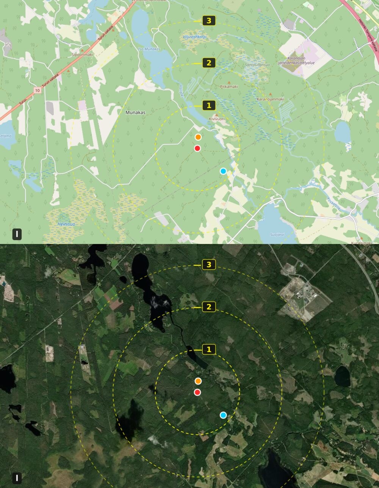

# Hämeenlinna autumn cottage trip — Mon 19 → Wed 21 Oct 2026

**Who:** 2 adults + boy 4 y + girl 2 y
**Base:** Katiskosken joenrantamökki, Katiskoskentie 450, 13500 Hämeenlinna — **N 60° 55.240 / E 24° 26.674 = 60.9206667, 24.4445667** (riverside cottage, sauna + hot tub)
**Set your nav to the coordinates**, not the street number: `Katiskoskentie` is a ~4.6 km road and the number alone geocodes to two different ends.
**Logistics:** no check-in dependency — luggage and all four bikes stay locked in the car; you only carry a day-bag to the cottage each evening.
**Start:** driving from Lahti Monday morning
**Focus:** forest bike riding near the cottage, short kid-sized hikes, culture & history that works with small children, pizza + sushi, and the evening sauna/hot tub

*Häme Castle (Hämeen linna), the 13th-century castle the city is named after. Photo: Wikimedia Commons, CC BY-SA.*

---

## 📍 Where the cottage actually is

Coordinates **60.9206667, 24.4445667** (N 60° 55.240 / E 24° 26.674) put you at the **Katiskoski end of Katiskoskentie**, in the Katiskoski / Hattelmala area of former **Kalvola**, about **11 km northwest of Hämeenlinna centre**. Verified against OpenStreetMap:

| From the cottage door | Car | Bike |
|---|---|---|
| **Häme Castle** (Kustaa III:n katu 6) | 12.8 km / **17 min** | 11.7 km / 59 min |
| Museo Militaria · Popino · Goodman/Ajito | ~12.9 km / 18 min | ~11.3 km |
| Ravintola Piparkakkutalo (Kirkkorinne 2) | 12.9 km / 18 min | 11.7 km / 59 min |
| **Aulanko Ulkoilumaja** (Linnanen 77) | 9.3 km / **16 min** | 8.5 km / 47 min |
| Aulanko näkötorni (view tower) | 10.2 km / 17 min | 9.5 km / 51 min |
| **Ahvenisto / Appara** (Olympiakatu 18–20) | 11.0 km / **23 min** | 11.8 km / 58 min |
| Ravintola Bora (pizza, Hätilänkatu 1) | 14.3 km / 25 min | — |
| HugoPark / Scandic Aulanko (Aulangontie 93) | 17.6 km / 30 min | — |
| Iittala Design Village | 20.9 km / 29 min | 14.2 km / 86 min |
| **Lahti city centre** | **86.2 km / ~88 min** | — |

**These coordinates make much more sense than the street-number geocode — they fix the riverside question.** At 60.9206667, 24.4445667 OpenStreetMap puts the **river Jokilanjoki ~27 m away**, i.e. essentially at the cottage, and `Katiskoskentie` itself ~33 m away. That is exactly what *"Katiskosken **joenrantamökki**"* (Katiskoski riverside cottage) should look like: a house on the bank of the river at the rapids.

For transparency: my earlier coordinates from the street number (60.9204924, 24.4373749) sat **~395 m west** of this point and found no named watercourse within ~430 m — which is why I hedged. The new position resolves it, so **treat Jokilanjoki as your river**. It's part of the Vanajavesi catchment; the rapids that give Katiskoski ("trap rapids") its name are in this stretch.

⚠️ Still worth a sanity check before you drive: 27 m from a mapped river centreline means the house may sit on the *near* bank or just across it. Ask the host to confirm the coordinates match the actual building, and whether the bank is yours to use.

## ⚠️ Three questions for the host before you leave

1. **Can we ride bikes straight from the door?** Asphalt, gravel or sand? (Sand + frost heaves = misery with a 4-year-old on his own bike and a 2-year-old who can't.) Katiskoskentie is an *unclassified* rural road in OSM — narrow, no shoulder.
2. **Is there a safe place to launch the kids' bikes** — yard, pihamaa or a dead-end — and **is there a legal/safe route anywhere nearby**, or should we plan to load the bikes and drive to Aulanko/Ahvenisto?
3. **Sauna + hot tub:** how long does the stove take, is firewood included, do we need to book a heating slot, and is the water potable for filling the tub?
4. **Where do we dump rubbish / grey water**, and can we park right at the door with the car loaded with bikes (relevant if it rains while you're unloading)?

### Good news from the "everything stays in the car" plan
You don't need early check-in at all, and nothing needs to be secure during the day. Practical consequences I've built into the schedule:
- **Monday 10:00 becomes a real activity hour** instead of a luggage-drop wait — see the revised Day 1.
- Keep a **dry change of clothes + dry shoes per person in a sealed bag** in the car; October cottage yards are wet and kids get soaked.
- The **sauna is your laundry/ drying room**: hang wet socks, mitts and bike gloves there each night (not on the hot tub cover).
- Bikes in a car boot with two kid bikes + two adults' = pack them **wheels-in, down Tube** if you have quick-release front wheels; do this at home tonight so Monday isn't spent fiddling with a seatpost in a cold car park.

**Honesty note on sources:** I could not verify the cottage listing itself. The Finnish cottage-booking sites that normally carry this kind of property (`menomajo.fi`, `lomareitti.fi`, `majoitusnomi.fi`) were unreachable from my network, and Google/Bing/DuckDuckGo/Tripadvisor all blocked automated access. **Everything about the cottage (sauna, hot tub, bikes, water frontage) therefore comes from you, not from a source.** Everything else in this plan is linked and dated.

---

## Weather forecast (checked 18 Oct 2026)

Source: [Open-Meteo](https://open-meteo.com/) forecast for **60.9207, 24.4446** (the cottage itself), model run of Sun 18 Oct 2026 — **re-check Monday morning.**

| | Mon 19 Oct | Tue 20 Oct | Wed 21 Oct |
|---|---|---|---|
| Sky | Cloudy → **clearing through the afternoon** | Overcast | Cloudy, showers possible |
| High / Low | **+7 °C / −1 °C** | **+7 °C / −1 °C** | +9 °C / +2 °C |
| Precipitation | **0 mm, 0 % chance** | **0 mm, 0 % chance** | **~2.4 mm of rain/shower possible, 39 %** |
| Wind | 4 km/h (calm) | 8 km/h (light) | 15–20 km/h |
| Sunrise / sunset | 08:13 → **17:59** | 08:16 → 17:56 | 08:19 → 17:53 |

**What this means for the plan:**
- **Monday is the best outdoor day** → bikes and Aulanko on Monday, castle on Tuesday.
- Mornings freeze (**−1 °C**): lakes and paths will be icy/slippery, cottage yard may be frosted. Bike tyres will feel crunchy — leave the "walk to the lake for skipping stones" until after 11:00.
- Only **~9.5 hours of daylight**, gone by 18:00. Build in a headlamp or two for any late forest walk; the sauna/hot tub becomes the evening plan, and it's perfect for it.
- Wednesday is windier and drizzly → travel home before lunch, culture stops are indoor-friendly.

---

## Day 0 (Sun evening) — Pack list that makes or breaks an October trip

- **Bikes:** 2 adult + 2 kid bikes. If any adult is strong enough, bring a **half-bike / follow-me coupling or a small trailer** — the 4-year-old will tire after ~3 km of gravel and the 2-year-old cannot ride distance at all. This is the single biggest trip-planning constraint for your group.
- **Warm layering for riding:** windproof shell, hat + thin gloves under spare mitts, warm socks. Riding is slow and cold in +5 °C; parents get cold faster than kids.
- **Headlamp** (one per adult), **thermos** with hot juice/cocoa, evästä (sausage for the fire = *makkaraa*). Check the current **fire warning** before any outdoor grill/fire via the Finnish Rescue Association site or the official **Sparkriski app** (both were unreachable from my network, so verify on arrival (note: cottage saunas and grills are normally fine; it's grassland/forest-floor fire that is regulated).
- **Sauna/hot tub:** towels + sandals, cheap **water shoes or thick socks** for the frost-cold deck between hot tub and cottage. Check the cottage's water is potable before filling the tub.
- **Kids' outing kit:** a small backpack each with a wind suit, hat, plasters, and something to throw at squirrels.
- **For the castle:** the tower/stair tours are not buggy-friendly; bring the **baby carrier** for the 2-year-old rather than the stroller (see castle accessibility note below).

---

## Day 1 — Monday 19 Oct: Lahti → cottage → Aulanko forest & bikes 🚲

*Best weather day. Clear afternoon, calm wind, +7 °C.*

### 08:00 — Leave Lahti
Lahti → cottage: **86.2 km, ~88 min** door to door (OSRM/OpenStreetMap routing, direct). Going via Hämeenlinna centre or the E75 Tönnistö exit adds several minutes for no benefit, so take the direct route and book nothing before 10:00. Fill the fuel tank in Lahti and grab a *pullapussi*: the last stretch on Katiskoskentie is rural single-carriageway with nothing on it.

### 10:00 — Arrive, unpack bikes, get bearings (no check-in needed)
Since everything stays locked in the car, **you are free from the moment you arrive** — no waiting on a 16:00 check-in, nothing to carry inside. Let both kids burn off car-legs in the yard while you sort bikes, then ride or walk right from there.

Local orientation from your exact coordinates:
- You are in **Katiskoski** ("trap rapids") village, Hattelmala area, former **Kalvola** — **~11 km as the crow flies / 12.8 km driving northwest of Hämeenlinna centre**.
- The **river Jokilanjoki is ~27 m from your door** according to OpenStreetMap, and the Katiskoski road bend/rapids are ~250–430 m along it. A short walk to moving water with a 4-year-old is an event in itself — ask the host exactly where you may go, since the banks may be private or steep.
- Other mapped water: **Välijoki ~1.2 km** (also Vanajavesi catchment).

### 11:00–13:30 — Ride from the cottage door (see the map below this section)
I queried OpenStreetMap for every `track` and `path` around your coordinates. The headline: **the network is dense but unmapped** — **41.1 km of track/path within 2.5 km**, of which **19.4 km have no surface tag at all**. So treat the map as "there are tracks, go and look," not "here is a signed route." What OSM *does* tell you, segment by segment:

| Starts | Length | Surface (OSM) | Direction from cottage |
|---|---|---|---|
| **0.24 km** | 1.39 km | **gravel** | SW (225°) |
| 0.58 km | 3.02 km | ⚠️ **mud** | SW (241°) |
| 0.79 km | 1.41 km | unmapped | NE (48°) |
| 0.88 km | 1.51 km | unmapped | S (185°) |
| **1.22 km** | 3.42 km | **gravel** | NE (60°) |
| 1.27 km | 1.37 km | gravel | N |
| 1.36–1.37 km | 1.07 + 1.25 km | gravel | NW / N |

**The one I'd actually ride with your group:** the **gravel track that starts ~640 m from the door and runs 1.4 km southwest**. Short approach, decent surface, and you can out-and-back it in ~3 km of rolling (≈4 km including the approach). Avoid the 3 km segment starting ~970 m away — OSM tags it **`surface=mud`**, which in October means exactly what you fear for a kid bike. The nearest option of all is an **untagged track starting ~420 m to the north-east (1.4 km long)** — worth a 5-minute look from the door before you commit.

Rules of thumb for this group:
- Gravel + frost = drop tyre pressure and expect to walk parts of it. The 4-year-old's limit is ~3 km; plan the outing around *that*, not around the map.
- `Katiskoskentie` here is an **unclassified rural road with no cycle lane and no shoulder**. If it feels too exposed, don't fight it — **load the bikes and drive the 9.3 km / 16 min to Aulanko**, where you can ride entirely off-road.
- **Print or screenshot the satellite image below** and show it to the host: *"which of these tracks actually exist and are rideable?"* Local knowledge beats OSM here, and they'll point you at the one that isn't a logging trail.

## 🗺️ The cottage area — map + satellite (annotated)

Two views of the same **10.5 × 6.5 km** window, top = OpenStreetMap, bottom = satellite. Both carry the same overlay: **yellow dashed rings at 1 / 2 / 3 km from your cottage door** (each ring has a boxed number on the north side) and three dots.

| Marker | What it is | Distance from cottage |
|---|---|---|
| 🔴 red dot | **Cottage, Katiskoskentie 450** (60.9206667, 24.4445667) | 0 m |
| 🟠 orange dot | **Katiskoski village road bend** — where the rapids are named for | ~430 m WNW |
| 🔵 cyan dot | **Jokilanjoki river** (the river you front; nearest OSM point ~27 m from the cottage) | 0 m |

The orange and cyan markers sit right beside the red one — which is precisely the point of the corrected coordinates.

*Basemaps: © OpenStreetMap contributors (tile.openstreetmap.org, z13) and Esri World Imagery, served via images.weserv.nl. Rings, dots and scale bar drawn by me.*

**Two build bugs I hit on the way, so you know what to trust:** (1) my first attempt baked text into the image with ImageMagick's internal font renderer, which had no font available and drew every glyph as a hollow box. (2) The fix then composited an SVG overlay whose **white background was opaque**, so it painted over both map panels and you got a white rectangle — that is what you saw. Both are now resolved: the overlay is rendered with a transparent background before compositing, and I verified it pixel-by-pixel rather than by eye — forest at (100,100) = `#ADD19E`, the 1 km ring east of the cottage = `#FEF10A`, satellite panel below = `#34462E`. Text is deliberately **not** drawn into the image at all; every name lives in the table above.

**Vector version of the overlay** (rings, dots and 1/2/3 km markers as real SVG geometry — opens sharp at any zoom): [`img/katiskoski_cottage_area_map.svg`](img/katiskoski_cottage_area_map.svg)

**What to look for in the satellite strip:** the cottage sits where Katiskoskentie threads between lake, forest and river at the rapids. The **south-west and north-east quadrants carry the most continuous pale lines** — those are the tracks in the table above, including the gravel spur to the SW. Ground right along the river is more broken up, which matches that corner holding the `surface=mud` segment.

## 17:30 — Back to the cottage: first sauna + hot tub night
This is your anchor every evening; treat it as the main event, not the afterthought.
- Light the sauna early (ask the host how long the stove takes — plan **2–2.5 h**).
- With air at 0…+5 °C and water nearby, the hot tub at ~+38 °C with cold air on the face is the highlight of a Finnish October for a 4-year-old. Set a timer for the 2-year-old (short dips, keep head dry and warm).
- **Night idea:** after the tub, one adult walks the kids to the dark with a headlamp for a 10-minute "owl hunt." Frost + silence + torches is what they'll remember.

### Dinner option for Monday (if you don't want to cook)
Nothing verified in Katiskoski itself. Closest known sit-down options are in town (see Day 2) — most cottage groups simply do grilled sausage over the cottage fire on night one. If you want certainty, buy groceries in Lahti or at the **K-Citymarket/Hämeenlinna** side before turning off onto Katiskoskentie.

---

## Day 2 — Tuesday 20 Oct: Häme Castle + town 🏰

*Overcast and still dry. Castle first, indoor warmth, then optional rain-proof town stops.*

### One thing that is definitely NOT happening
The castle's autumn school-holiday children's programme ran **13–18 October 2026** and has now ended, so there is nothing extra to plan around on Tue 20 / Wed 21 — no booking needed and nothing to chase. The castle itself is open year-round as normal (hours below), and the permanent exhibitions listed there are exactly what works with a 4-year-old.

### Hämeen linna (Häme Castle) — the main event
Scandinavia's best-preserved stone castle, building began in the 1200s, brick-built (unusual in Finland), later a prison, now a museum open year-round.

- 📍 **Kustaa III:n katu 6, 13100 Hämeenlinna**
- ☎️ **+358 295 33 6931** (ticket sales)
- ⏰ **Tue–Fri 10:00–16:00, Sat–Sun 11:00–16:00, Monday closed** — verified on the National Museum of Finland site ([Hämeen linna](https://suomenkansallismuseo.fi/kohde/hameen-linna/))
- 💰 **Adults €15 · reduced €10 · children 7–17 €7 · family ticket (2 adults + up to 4 children) €35** → **your family pays €35**
- 🎟️ Buy online via the "Osta lippu" link on that page; also check whether a **Museokortti** ([museot.fi](https://museot.fi/)) pays off — with Häme Castle + Art Museum + Skogster in one trip it often does, and under-18s go free in city museums anyway.
- Current exhibitions worth hunting out with a 4-year-old: the **model room** (3 scale models of the castle through the ages, 3rd floor), the **Arsenal (*Asehuone*)** with swords, pikes, cannonballs and a crossbow, the **Knight's Hall & Queen's Chamber** (armour, altar robe, tapestry, sword), and the **Sysmä treasure** of silver coins and jewellery on the 2.5 landing.
- Also in the castle: *Karnevaali – ITE-taidetta linnassa* (outsider-art exhibition, **28 May 2026 – 7 Mar 2027**), plus museum shop and a museum café/restaurant in the Kruununleipomo bakery.

**Accessibility / toddler reality check (their own words):** *"the courtyard is paved with uneven natural stones, the stairs are steep, some doorways are narrow and low, the interiors are maze-like with many level changes and thresholds… altering the medieval structures is practically impossible."*
→ **Bring a carrier for the 2-year-old, not a stroller.** Expect to carry. The castle warns it's cold inside in autumn — keep layers on.

### Right next door (5-minute walk): Museo Militaria
One of Finland's largest war-history museums, three floors plus an outdoor yard of **cannons from the 1870s to the 1980s**, pioneer heavy equipment and hands-on telegraphing stations. For a 4-year-old boy, the cannon yard is often better than the castle.

- 📍 Vanhankaupunginkatu 19 · ☎️ +358 40 450 7479
- ⏰ **Autumn season (1 Sept – 15 Dec): Tue–Sun 11:00–17:00, Mondays closed** ([Museo Militaria in English](https://www.museomilitaria.fi/museum-militaria-in-english))
- 💰 Adults €11 · children 7–17 €6 · **family ticket €25** (under-7s free in practice — confirm at the desk)
- 🎟️ **Winter combination ticket (1 Sept – 15 Dec): Militaria + Häme Castle, adults €17 / children 7–17 €9.** If your 4-year-old is charged as a child this is *more* than the castle family ticket alone, so compare at the counter: **€35 castle family ticket vs €17×2 + €9** for Militaria+Castle. Buy the one that fits how many museums you actually enter.

### ❌ Vankila (Prison Museum) — do not plan on it
Finland's largest prison museum, in the 1871 building next to the castle, is **closed for the season**: its own page currently shows **"Suljettu tänään / closed all days"** and the city states plainly that *"Vankila is open during the summer season from May to September."* Prices if you ever come back: adults €14, children 7–17 €7, family €30.
Source: [Vankila](https://suomenkansallismuseo.fi/kohde/vankila/) · [Museoiden Hämeenlinna](https://www.hameenlinna.fi/matkailu-ja-tapahtumat/kohteita/museot/)

### Lunch — Tuesday 12:30 or 13:30
**Popino**, Raatihuoneenkatu 25 (5 min walk from the castle): *"For the love of food since 1988"*, lunch + à la carte, family-friendly.
⏰ **Mon–Thu 11–21, Fri–Sat 11–22, Sun 12–20**, kitchen closes an hour before. [popino.fi](https://popino.fi/)

### Afternoon — one or two of these (all short, all kid-tolerant)
- **Vanajavesi shoreline walk (*Rantareitti*)** — ~6 km total through 13 parks from the castle towards Aulanko; do the **castle → Hämeensaari park → Sarjanpuisto stretch (800 m–1.5 km)**. Free, flat, playgrounds and pavilions on the way. ([Top 10](https://www.hameenlinna.fi/matkailu-ja-tapahtumat/nae-ja-koe-hameenlinnassa/top-10-nahtavyydet-hameenlinnassa/))
- **Hämeenlinna Art Museum** — Verkatehdas area, two buildings of changing exhibitions. **Tue–Thu 11–18, Fri–Sun 11–17, Mondays closed. €12 / €10, under-18s free**, so for your family it's effectively **€24**. Current-ish shows listed by the city: *Antti Laitinen: Sisällä metsä* (9 May–**18 Oct 2026**, i.e. just finished) — check what's up before going. [hameenlinnantaidemuseo.fi/in-english](https://www.hameenlinnantaidemuseo.fi/in-english/)
- **Hämeenlinnan ortodoksinen kirkko** (Erottajakatu 20) — see Day 1's "new for you" pick; it's a 5-minute walk from Popino and fits either day. Hours unverified.
- **Hämeenlinna main church (*Hämeenlinnan kirkko*), Kirkkorinne 2** — the big 1791 cruciform church right by the castle hill, usually open to visitors in the daytime (lockable pram parking inside is common in Finnish churches). Free. Confirm times at the door; I could not reach a parish site to verify hours.
- **Rainy-hour backup: Hämeenlinna main library (*pääkirjasto*), Lukiokatu 2** — city-run, has family/children floors; ask for opening hours by phone **+358 3 621 2612**. ([Kirjasto](https://www.hameenlinna.fi/kulttuuri-ja-liikunta/kirjasto/))
- **Kids' indoor playground: KidsPark Hugola, Keksikatu 5** (listed by the city as an indoor play park; ☎️ +358 41 311 3046) — good if Tuesday turns wet and melty. [Seikkailu- ja perhepuistot](https://www.hameenlinna.fi/kohdekategoria/nae-ja-koe/?fwp_spotcard_categories_facet=seikkailu-ja-perhepuistot)

### 🍕 Pizza / 🍣 Sushi — where you actually eat
The city's own restaurant listing has these ([Syö ja juo Hämeenlinnassa](https://www.hameenlinna.fi/kohdekategoria/syo-ja-juo/?fwp_spotcard_categories_facet=ruokaravintolat)):

| Place | What it is | Address | Verified? |
|---|---|---|---|
| **Ravintola Bora** | Mediterranean kitchen **+ wood-fired-oven Italian pizzas** (Margherita €12.90, 4-topping "Fantasia" €19.90), A-rights, big beer/cider list, lots of free parking | Hätilänkatu 1 / Viipurintie side, 13210 Hämeenlinna | ✅ own site [bora.fi](https://bora.fi/) + city listing — **best pizza pick** |
| **Little Italy** | Casual restaurant of Scandic Aulanko: antipasti, **pizza**, pasta, burgers | Aulangontie 93 (i.e. on your way home from Aulanko!) | ✅ city listing; phone **+358 3 4108 1633**; I could not reach its own site — **call to confirm it's serving in late Oct** |
| **Ajito Sushi & Buffet** | Asian/sushi restaurant and buffet in the basement of **Kauppakeskus Goodman** | Kaivokatu 7, 13100 | ✅ city listing + OpenStreetMap; phone **+358 46 922 9882**. ⚠️ Its own website (`ajitosushi.fi`) is currently serving **casino spam instead of restaurant content** — treat that domain as untrustworthy and verify by phone. A buffet is honestly the safest option with a picky 4-year-old and a 2-year-old. |
| **Kauno Kitchen** | Vietnamese (phở, bún, curries) **and sushi**, lunch & dinner, vegan options | Hallituskatu 22, 13100 | ✅ city listing; phone +358 40 041 5224 |
| **Ravintola Piparkakkutalo** | Your "nice place": seasonal menu from the Josper charcoal grill since 1987. Day's dish €32 (e.g. veal picanha). **Tue–Thu 17–22, Fri 15–23, Sat 12–23, Sun–Mon closed**, kitchen until 21:00/21:30 | Kirkkorinne 2 (castle hill) | ✅ own site [ravintolapiparkakkutalo.fi](https://www.ravintolapiparkakkutalo.fi/) — book ahead: **+358 3 648 040** |
| **Pancho Villa / Las Palmas / Fifth Avenue / Dragon / Himalaya Kitchen / Jiao Long** | chains & alternatives if the above are full | various, all central | listed by city; not independently verified |

**My recommendation:** Monday evening = cottage fire + take-your-own food. Tuesday evening = **Ajito Sushi buffet at Goodman for the kids + Piparkakkutalo or Bora for a nicer adult meal**, choosing one to keep it simple with two small children (Piparkakkutalo is Tue–Sat evenings, so Tuesday works).

---

## Day 3 — Wednesday 21 Oct: last ride, then home (windy/drizzly)

### 08:30 – 10:30 — Slow morning at the water
Pack up, let the kids do one more lap of the cottage area. If the sauna is still warm, use it in the morning — hot tub at 07:30 with mist over the river is worth setting an alarm for.

### Option A (best if weather holds): **Ahvenisto / Appara** — 11.0 km / 23 min from the cottage door
An esker nature-reserve activity centre built for the **1952 Helsinki Olympics** (the modern pentathlon ran here), a short drive from the centre and, more importantly for you, close to the cottage road.

Verified from [City of Hämeenlinna – Ahvenisto](https://www.hameenlinna.fi/matkailu-ja-tapahtumat/nae-ja-koe-hameenlinnassa/ahvenisto/):
- **~6 km circular nature trail** on the Ahvenisto esker, marked with **yellow triangles** in the terrain — good half-loop with kids.
- **Ahvenistonjärvi beach**: sand beach with piers, spring-fed crystal-clear water, café, 3 beach-volley courts, a free **kota (smoke sauna hut/fire shelter)** for picnic, and a big fenced playground whose centrepiece is a **pirate ship with a climbing watchtower net** — the single best thing on this list for a 4-year-old and a 2-year-old.
- **Appara adventure/rope park, bike and SUP rentals** run by Appara Elämyskeskus (Olympiakatu 18–20, ☎️ +358 50 350 9295) — the city explicitly mentions **mountain bikes for rent**. I could not verify current prices or autumn opening times on their site, so phone.
- ⚠️ The **Ahveniston maauimala outdoor pool closed for the season** ("opens in May"), so this is a walk/playground/ride visit, not a swimming one.
- 🚌 If you ever come without a car: local buses **1, 3 and 14** pass Ahvenisto.

### Option B (if it's raining sideways): indoor culture, all near the castle
- **Museo Skogster / Hämeenlinna City Museum** — city history + Savings Bank Museum (a reconstructed 1920s bank hall kids find oddly fascinating). Current exhibition *Yöperhoset – kimallusta ja kannanottoja* runs **16 June 2026 – 3 Jan 2027**. Part of the city museum, so under-18 free; adult admission small (confirm: [hmlmuseo.fi](https://hmlmuseo.fi/en/home/museums/skogster-museum/) was behind a bot-check for me).
- **Birthplace of Jean Sibelius** — Hämeenlinna-born composer (1865–1957); small, cosy, quick — good for 45 min with a short attention span. ([City museum page](https://www.hameenlinna.fi/matkailu-ja-tapahtumat/kohteita/museot/))
- **Hämeenlinna Art Museum** (Tue–Thu 11–18) if you skipped it Tuesday.

### Option C — big swing, only if the forecast turns gorgeous: **Iittala Design Village**
20.9 km / ~24 min from the cottage (13.2 km if you cycle). Glass factory where you can watch glassblowing, Iittala outlet, naïve-art exhibitions and lots of small craft shops; the city calls it *"an excellent day-trip destination: less than 15 minutes by train or 20 minutes by car from Hämeenlinna centre."* Note the big *Naivistit Iittalassa* summer exhibition ended **30 Aug 2026**, so expect shops + glassblowing rather than a special show. [Iittala page](https://www.hameenlinna.fi/en/tourism-and-events/iittala-design-arts-and-culture/)

### Depart for Lahti: 12:30–13:30
Cottage → Lahti **86.2 km, ~88 min**. Leave by 13:00 and you're home before 15:00 with the kids' nap window used. Since the bikes live in the car, **give them a rinse/wipe-down on Wednesday morning, not at check-out**, so you don't open the boot on a rainy roadside later. Check out is usually 12:00 — take the rubbish out and leave the sauna *syötyinä* (fed/clean); that's the cottage-culture tax.

---

## Bike-specific notes (the honest version)

**Where I could and couldn't verify riding:** Hämeenlinna's official outdoor page lists a comprehensive year-round trail network, but it does **not** publish an "official MTB trails near Katiskoski" list I could reach. What I *can* tell you from verified sources:

- **Aulanko MTB route, 13.8 km**, marked in the park forest — roots, rock sections, steep climb to the viewpoint ([Aulanko page](https://www.hameenlinna.fi/matkailu-ja-tapahtumat/nae-ja-koe-hameenlinnassa/luontoelamysten-aulanko/)).
- **Ahvenisto's Olympic-era outdoor and running routes** on the esker + the 6 km yellow-triangle loop, and **mountain bikes for rent** at Appara ([Ahvenisto page](https://www.hameenlinna.fi/matkailu-ja-tapahtumat/nae-ja-koe-hameenlinnassa/ahvenisto/)).
- **Hämeen Ilvesreitti** — a 250+ km regional hiking/backpacking trail network (Hattula → Ahvenisto → Tammela National Park → Riihimäki) that runs through this part of Häme; the city says the whole network is mapped in the national recreation-site service, searchable as "Hämeen Ilvesreitti" in the national recreation-site database (Latu's `latu.fi`, which timed out for me). Overkill for this trip, but it confirms the region is serious about forest trails.
- **New in 2026:** the city announced (6 Oct 2026) that construction of the **Tytyri mountain-bike trail network** — won by Hämeenlinna's participatory budgeting — starts in October 2026, and that **Aulanko's outdoor route was widened** during Aug–Sep 2026. So expect some works/earth on Aulanko routes. Source: [Ulkoilu ja retkeily – news items](https://www.hameenlinna.fi/kulttuuri-ja-liikunta/liikunta-ja-ulkoilu/ulkoilu-ja-retkeily/)
- **Nothing *signed* is mapped at Katiskoski itself, but there is plenty to ride.** Within 2.5 km of your door OSM holds **138 track/path ways totalling 41.1 km** (gravel 13.1 km, ground 5.2 km, mud 3.4 km, **untagged 19.4 km**) — see the table and annotated map in Day 1. None of it is a named/signed cycle route; it's working forest and settlement track, which is precisely what makes it worth exploring with a local's tip.
- **Everyman's rights:** in Finland you may cycle on forest tracks and paths at your own risk, but **not** on cultivated land or private yard roads, and organised motorised trail use is regulated — irrelevant for bikes, relevant if anyone fancies a shortcut across a field. There is no official "kids' forest bike park" I could verify within the cottage's immediate 5 km.

**Practical conclusion:** do one **out-and-back on the gravel track ~640 m southwest of the door** (≈4 km including approach, kid-legal) as your "we rode from the cottage" ride, then use **Aulanko + Ahvenisto** (both ≤20 min drive) for anything longer or more technical. Keep the bikes in the car between the two — don't try to link Katiskoskentie to town on road.

---

## Booking checklist (do these today, from the sources above)

- [ ] **Cottage host:** bike surface at the door + where kids can ride safely, exactly which water you front and where you may walk to it, sauna heating time/wood, hot tub filling & rules, early luggage drop Monday ~10:00.
- [ ] **Häme Castle** — buy 1 family ticket (€35) for Tue 20 Oct; ask about children's programme after 18 Oct: **+358 295 33 6931**.
- [ ] **Piparkakkutalo** table for Tuesday evening (Tue–Thu 17–22): **+358 3 648 040**.
- [ ] **Ajito Sushi** (kids' buffet) availability: **+358 46 922 9882**. *(Ignore their website — it's currently serving casino spam.)*
- [ ] **Appara Elämyskeskus**: bike rental + rope-park autumn opening: **+358 50 350 9295**.
- [ ] Optional: **HugoPark Aulanko** ropes park if the kids are up for it — open on **Sat–Sun 11–18/12–18 in October**; the "syysloma" (school-holiday) week Mon–Sat schedule ended **18 Oct**, so a Monday visit needs confirmation. **Child ticket €15 (< 120 cm, 2 courses), family ticket €95 (2 adults + 2 children under 16), adult €28**; gloves mandatory (buy on site €4/pair); last entry 1 h before closing; max 130 kg. [hugopark.fi/aukioloajat](https://www.hugopark.fi/aukioloajat/) · [prices](https://www.hugopark.fi/hinnat-prices)
- [ ] Optional: **private guided tour** by Hämeenlinnan Oppaat (the local guide association; Aulanko is their most-requested site). Foreign-language guiding **€200 for 2 h, €240 for 3 h** (Finnish €150/€190), Sunday surcharge +100 %, admission not included. Book: [hameenlinnanoppaat.fi/yhteydenotto](https://hameenlinnanoppaat.fi/yhteydenotto/) · [prices](https://hameenlinnanoppaat.fi/hinnasto/)
- [ ] Re-check the forecast Monday morning (Open-Meteo link above) and **fire warnings** before using any outdoor fire.

---

## Budget sketch (family of 4, excluding cottage & fuel)

| Item | € |
|---|---|
| Häme Castle family ticket (2 adults + up to 4 children) | **35** |
| Museo Militaria (if added separately: 2 × €11, under-7 free — confirm) | ~22 |
| Hämeenlinna Art Museum (adults €12, under-18 free) | 24 |
| Tuesday dinner out (kids' sushi buffet + 2 adult mains at Piparkakkutalo/Bora) | ~90–130 |
| Monday cottage food / groceries | ~50 |
| HugoPark child ticket (optional, 4-y-o < 120 cm) | 15 |
| Parking in Hämeenlinna centre (€2/h, free Sat after 16:00 & Sun; **weekdays 8–18, Sat 8–16**) | ~4 |
| **Rough total for the culture + food parts** | **~190–250** |

Centre parking fees and rules are from the city's [mobility page](https://www.hameenlinna.fi/en/housing-and-environment/public-transport-and-mobility-in-hameenlinna/). EUR/USD reference on 16 Oct 2026 was 1.1253 ([Frankfurter/ECB](https://api.frankfurter.app/latest?from=EUR&to=USD)) if you're budgeting in dollars.

---

## If you only have energy for three things

1. **Monday afternoon at Aulanko**: Joutsenlampi loop + Bear Cave stairs + the free 1906 view tower, with bikes on the park roads and sausage on a fire.
2. **Tuesday at Häme Castle** (family ticket €35) plus the cannon yard at Museo Militaria — this is the culture/history your 4-year-old will actually remember.
3. **The sauna and hot tub every single evening**, with the headlamp walk after it. That's what a Finnish October cottage trip is for.

---

## Sources checked (18 Oct 2026)

- City of Hämeenlinna — [Top 10 sights](https://www.hameenlinna.fi/matkailu-ja-tapahtumat/nae-ja-koe-hameenlinnassa/top-10-nahtavyydet-hameenlinnassa/), [Aulanko](https://www.hameenlinna.fi/matkailu-ja-tapahtumat/nae-ja-koe-hameenlinnassa/luontoelamysten-aulanko/), [Ahvenisto](https://www.hameenlinna.fi/matkailu-ja-tapahtumat/nae-ja-koe-hameenlinnassa/ahvenisto/), [Museums](https://www.hameenlinna.fi/matkailu-ja-tapahtumat/kohteita/museot/), [Outdoor & hiking](https://www.hameenlinna.fi/kulttuuri-ja-liikunta/liikunta-ja-ulkoilu/ulkoilu-ja-retkeily/), [Swimming halls/beaches](https://www.hameenlinna.fi/hyvinvointi-ja-liikunta/liikunta-ja-ulkoilu/uimahallit-ja-rannat/), [Restaurants](https://www.hameenlinna.fi/kohdekategoria/syo-ja-juo/?fwp_spotcard_categories_facet=ruokaravintolat), [Mobility & parking](https://www.hameenlinna.fi/en/housing-and-environment/public-transport-and-mobility-in-hameenlinna/), [English Aulanko page](https://www.hameenlinna.fi/en/tourism-and-events/aulanko-the-beauty-of-finnish-nature/)
- National Museum of Finland — [Hämeen linna](https://suomenkansallismuseo.fi/kohde/hameen-linna/), [Vankila](https://suomenkansallismuseo.fi/kohde/vankila/)
- [Museo Militaria (EN)](https://www.museomilitaria.fi/museum-militaria-in-english) · [Hämeenlinna Art Museum (EN)](https://www.hameenlinnantaidemuseo.fi/in-english/)
- [Ravintola Bora](https://bora.fi/) · [Popino](https://popino.fi/) · [Piparkakkutalo](https://www.ravintolapiparkakkutalo.fi/) · [HugoPark Aulanko](https://www.hugopark.fi/aukioloajat) · [Hämeenlinnan Oppaat](https://hameenlinnanoppaat.fi/hinnasto/)
- Weather: [Open-Meteo](https://open-meteo.com/) (18 Oct 2026 run). Distances/times: OSRM on OpenStreetMap routing data, computed **from your coordinates 60.9206667, 24.4445667**; local hydrography/roads cross-checked with OpenStreetMap via the Overpass API (18 Oct 2026) — **every query is reproducible: see [`overpass_queries.md`](overpass_queries.md)**. Fire-warning services (`palontorjunta.fi`, Sparkriski) were unreachable from my network — verify locally.
- School-holiday context: Hämeenlinna early-childhood holiday dates — **syysloma week 42 = 12–16 Oct 2026** ([source page](https://www.hameenlinna.fi/varhaiskasvatus-ja-koulutus/varhaiskasvatus/loma-ja-paivystysajat/)), i.e. the crowds have gone home by your Monday.

### Known gaps (couldn't verify from this network)
Cottage listing & amenities · Ajito Sushi / Little Italy current opening hours and menus · Appara rental prices and autumn schedule · Museo Skogster/Skogster ticket prices (bot-check) · HugoPark opening on 19–21 Oct beyond the published October calendar · Ahvenisto/Retki-style nature centres near Aulanko (city lists *Aulanko Outdoors* and *Aulanko – Nature 360* as the area's activity/rental operators; `appara.fi` pages were not resolvable for content) · Hämeenlinna church opening hours (parish site unreachable).
